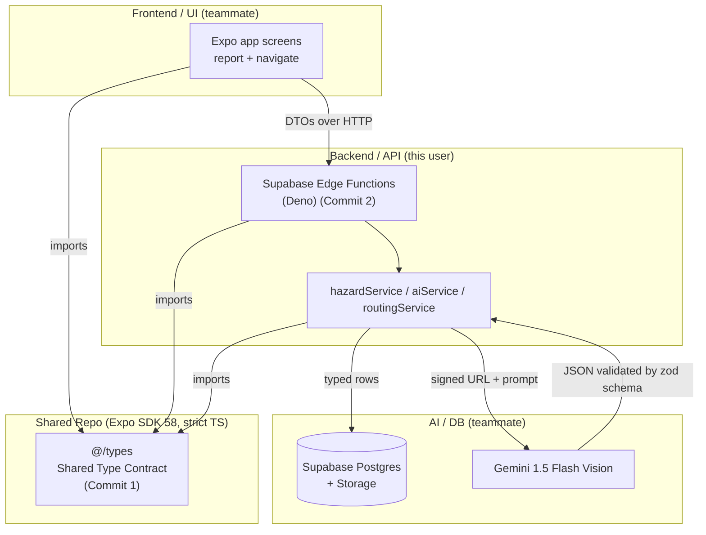
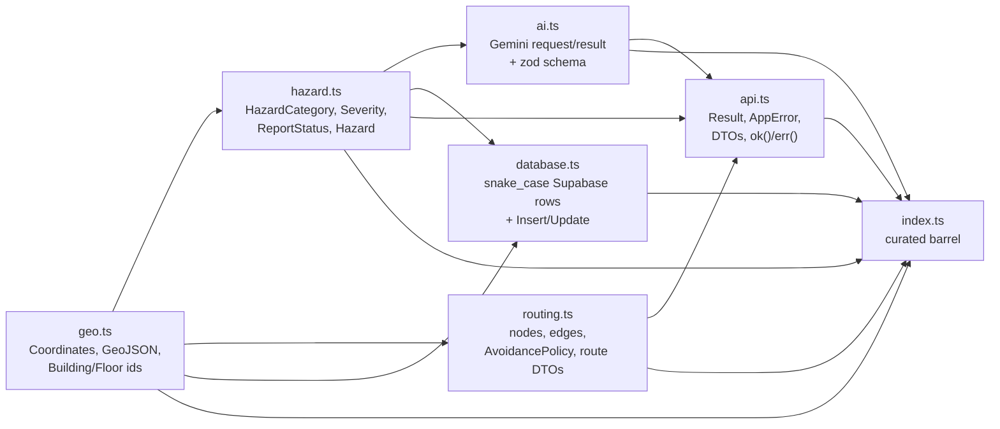
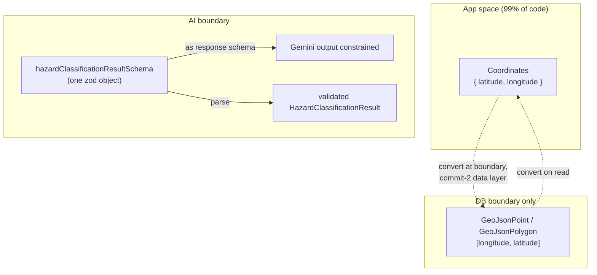
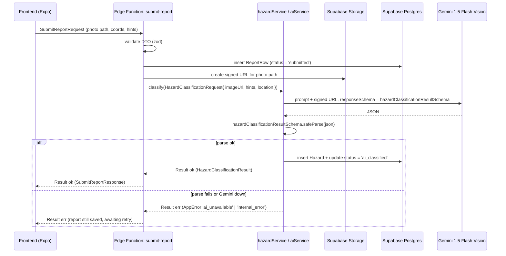
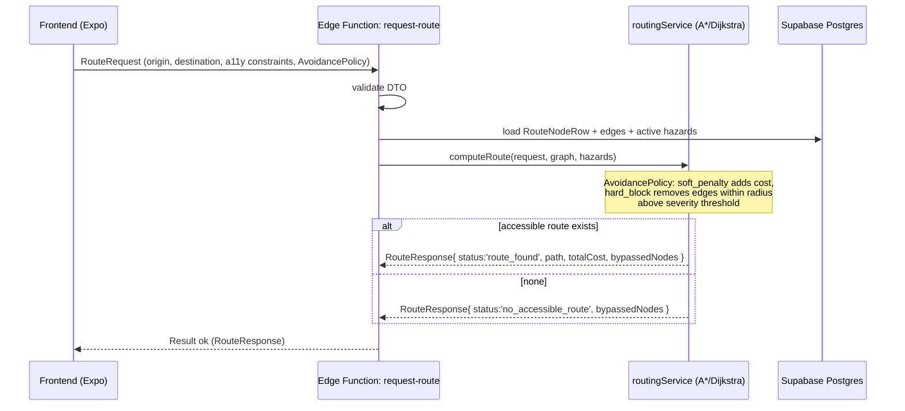
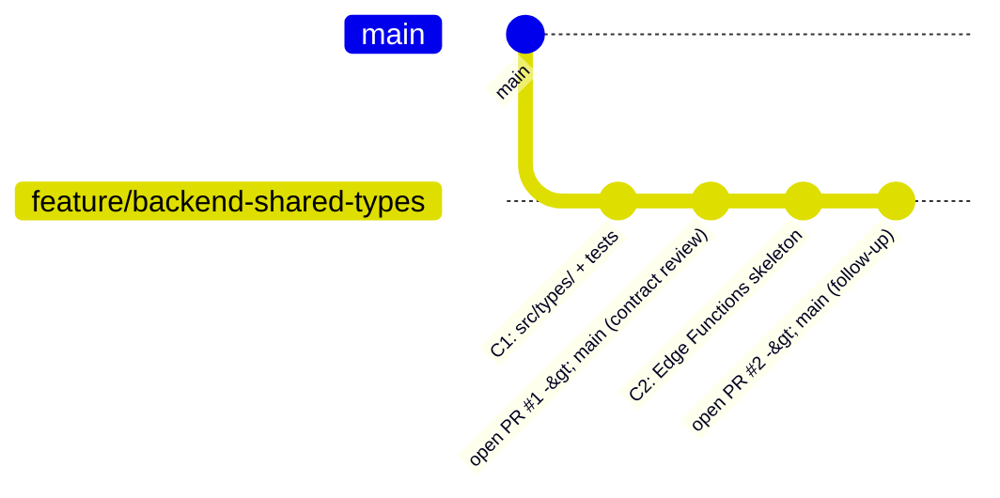

# Design Document: backend-shared-types

## Overview

AccessiBU is a crowdsourced campus hazard-reporting and accessible-navigation app for Boston University, built on a shared Expo SDK 58 repository. This spec covers the **backend/API tier** and, more importantly, the **shared TypeScript type contract** that sits between three owners: backend/API (this user), frontend/UI (a teammate), and AI/DB (a teammate). The type contract is the single source of truth that lets all three teams build in parallel without integration drift.

The work is scoped to **two commits delivered as two separate PRs into `main`**, both pushed to a feature branch (never directly to `main`):

- **Commit 1 — Shared Type Contract (`src/types/`, importable via `@/types`).** Seven files authored in dependency order (`geo` → `hazard` → `ai` → `routing` → `database` → `api` → `index`), plus a minimal test harness with type-level assertions and zod schema unit tests. This PR lands **first** so the teammates can review the contract before any implementation depends on it.
- **Commit 2 — Backend Skeleton (follow-up PR).** Supabase Edge Functions (Deno) built around the contract: typed/zod-validated env config, a typed Supabase client wrapper, a Gemini 1.5 Flash Vision client wrapper, domain services (`hazardService` / `aiService` / `routingService` with A*/Dijkstra honoring `AvoidancePolicy`), and the three Edge Functions (`submit-report`, `get-hazards`, `request-route`).

Everything is authored under **strict TypeScript** (`strict: true` is already on in `tsconfig.json`), and per `AGENTS.md`, Expo SDK 58 APIs, Supabase Edge Function APIs, and the GenAI SDK are verified against current docs rather than training data. Dependencies (zod) are installed via `npx expo install zod`, and `npx oxlint --deny-warnings` + `npx tsc --noEmit` gate task completion.

A key architectural decision threads through the whole contract: **geography is represented two ways on purpose** — an app-friendly `Coordinates { latitude; longitude }` shape used by almost all code, and a GeoJSON layer (`[longitude, latitude]` ordering) that lives only at the database boundary. Similarly, **Gemini's structured-output schema and the boundary-validation schema are the same zod object** (`hazardClassificationResultSchema`), which both constrains what Gemini may return and validates it on the way in — a research finding verified at ai.google.dev that the JS/TS GenAI SDK accepts a Zod schema directly as a response schema.

## Architecture

### System context — three owners, one contract



The contract (`@/types`) is the only thing all three teams share at compile time. Frontend and backend exchange **transport-neutral DTOs** defined in `api.ts`; the backend talks to Postgres using the hand-written row types in `database.ts` and to Gemini using the `ai.ts` contract.

### Type contract internal dependency graph



Authoring in this order guarantees every file only imports things already defined, keeping the strict-mode graph acyclic.

### Boundary strategy (geo + AI)



## Sequence Diagrams

### submit-report (triggers AI classification)



### request-route (accessible navigation with avoidance)



## Components and Interfaces

### Component 1: Shared Type Contract (`src/types/`) — Commit 1

**Purpose**: The compile-time integration surface between the three teams. Pure types plus a small amount of runtime value (zod schemas, const arrays, `ok`/`err` helpers). No I/O, no framework coupling, no transport assumptions.

**Responsibilities**:
- Define domain entities (`Hazard`, routing graph, geo primitives).
- Define the AI request/result contract and the single zod schema that doubles as Gemini's response schema.
- Define hand-written Supabase row types as the source of truth until the DB schema stabilizes.
- Define transport-neutral request/response DTOs and the `Result`/`AppError` envelope.
- Expose a curated barrel so consumers import from `@/types`, not deep paths.

### Component 2: Env Config (`config/env.ts`) — Commit 2

**Purpose**: Parse and validate server environment at startup with zod.

**Interface**:
```typescript
interface EnvConfig {
  supabaseUrl: string;
  supabaseServiceRoleKey: string; // server-only
  geminiApiKey: string;           // SERVER-ONLY, never bundled into the Expo app
}
function loadEnv(raw: Record<string, string | undefined>): EnvConfig; // throws on invalid
```

**Responsibilities**: Fail fast if any variable is missing/malformed. Guarantee `GEMINI_API_KEY` is only ever read server-side.

### Component 3: Supabase Client Wrapper (`clients/supabase.ts`) — Commit 2

**Purpose**: A thin typed accessor over the Supabase JS client, parameterized by the `database.ts` row types so queries are checked against the hand-written schema.

**Interface**:
```typescript
interface SupabaseGateway {
  insertReport(row: ReportInsert): Promise<Result<ReportRow>>;
  insertHazard(row: HazardInsert): Promise<Result<HazardRow>>;
  hazardsInRadius(center: Coordinates, radiusMeters: number): Promise<Result<HazardRow[]>>;
  createSignedUrl(path: string): Promise<Result<string>>;
}
```

### Component 4: Gemini Client Wrapper (`clients/gemini.ts`) — Commit 2

**Purpose**: Send a Storage signed URL plus a prompt to Gemini 1.5 Flash Vision, request structured output using `hazardClassificationResultSchema`, and return a `Result`.

**Interface**:
```typescript
interface GeminiGateway {
  classifyHazard(req: HazardClassificationRequest): Promise<Result<HazardClassificationResult>>;
}
```

**Responsibilities**: Never see raw image bytes (only the signed URL). Pass the zod schema as the response schema. `safeParse` the response and map failures to `AppError{ code: 'ai_unavailable' | 'internal_error' }`.

### Component 5: Domain Services — Commit 2

- **`hazardService`**: orchestrates submit-report (persist → classify → persist classification), and get-hazards queries.
- **`aiService`**: wraps `GeminiGateway`, owns prompt construction and the uncertainty policy (`isUncertain`).
- **`routingService`**: builds the graph from `RouteNodeRow`/edges, runs A*/Dijkstra honoring `AvoidancePolicy`, returns `RouteResponse`. **The algorithm itself is commit-2 scope; the contract only defines its data shapes.**

### Component 6: Edge Functions — Commit 2

Three Deno Edge Functions (`submit-report`, `get-hazards`, `request-route`), each validating its DTO, delegating to a service, and returning a `Result` envelope. Shared types are identical whether these run as Edge Functions or Expo Router API Routes; Edge Functions are the leaning choice.

## Data Models

The domain data models live in the low-level section below as concrete TypeScript. Summary of entities and their boundaries:

| Model | File | Boundary | Key rules |
|-------|------|----------|-----------|
| `Coordinates`, `GeoJsonPoint`, `GeoJsonPolygon`, `BuildingFootprint` | `geo.ts` | App vs DB | GeoJSON uses `[lng, lat]`; app uses `{latitude, longitude}` |
| `Hazard`, `HazardCategory`, `HazardSeverityLabel/Score`, `ReportStatus` | `hazard.ts` | Domain | Closed category union + `'other'` escape hatch with required `otherDescription`; severity label + 0–100 score; lifecycle statuses |
| `HazardClassificationRequest/Result` + zod schema | `ai.ts` | AI | Signed URL (no bytes); confidence 0–1; `isUncertain`; schema inferred type assignable to result type |
| `RouteGraphNode`, `RouteEdge`, `AvoidancePolicy`, `RouteRequest/Response` | `routing.ts` | Routing | Configurable soft-penalty vs hard-block avoidance; status discriminator |
| `HazardRow`, `ReportRow`, `RouteNodeRow`, `BuildingRow`, `ConfirmationRow`, `VoteRow` + Insert/Update | `database.ts` | DB | snake_case, timestamptz-as-string, nullable as returned, generated cols omitted on Insert |
| `Result`, `AppError`, DTOs, `ok`/`err` | `api.ts` | Transport | Closed error-code union; transport-neutral DTOs |

---

# Low-Level Design — Concrete TypeScript

All code below is authored under `strict: true`. Files are presented in dependency order. `@/types` resolves to `src/types/index.ts` via the existing `"@/*": ["./src/*"]` path alias.

## `src/types/geo.ts`

```typescript
// Geographic primitives.
//
// DECISION: AccessiBU represents geography TWO ways on purpose.
//  1. App-friendly `Coordinates { latitude, longitude }` — used by ~99% of code.
//  2. A GeoJSON layer (`GeoJsonPoint`/`GeoJsonPolygon`) used ONLY at the DB boundary,
//     because PostGIS / GeoJSON order coordinates as [longitude, latitude].
//
// GOTCHA: GeoJSON positions are [lng, lat] (X, Y), the OPPOSITE of the
// {latitude, longitude} order humans usually say. Conversion happens in the
// commit-2 data layer, never scattered through feature code.

/** App-friendly coordinate. Order: latitude first (human-readable). */
export interface Coordinates {
  readonly latitude: number;
  readonly longitude: number;
}

/** Opaque identifiers. Branded to prevent mixing building/floor ids with plain strings. */
export type BuildingId = string & { readonly __brand: 'BuildingId' };
export type FloorId = string & { readonly __brand: 'FloorId' };

/** App-friendly building footprint used by UI and routing. */
export interface BuildingFootprint {
  readonly buildingId: BuildingId;
  readonly name: string;
  readonly floors: readonly FloorId[];
  /** Simple polygon ring in app-friendly coordinate order. */
  readonly outline: readonly Coordinates[];
  readonly centroid: Coordinates;
}

// ---- GeoJSON boundary layer ([longitude, latitude] ordering) ----

/** A GeoJSON position: [longitude, latitude]. NOTE the lng/lat order. */
export type GeoJsonPosition = readonly [longitude: number, latitude: number];

export interface GeoJsonPoint {
  readonly type: 'Point';
  readonly coordinates: GeoJsonPosition;
}

export interface GeoJsonPolygon {
  readonly type: 'Polygon';
  /** Array of linear rings; first is the exterior ring. Each position is [lng, lat]. */
  readonly coordinates: readonly (readonly GeoJsonPosition[])[];
}
```

## `src/types/hazard.ts`

```typescript
import type { BuildingId, Coordinates, FloorId } from './geo';

// Centralized const arrays — reused downstream as zod enums (ai.ts) so the
// category/severity lists have exactly ONE source of truth.

/** Closed set of known hazard categories (excluding the escape hatch). */
export const HAZARD_CATEGORIES = [
  'spill',
  'broken_elevator',
  'blocked_path',
  'broken_door',
  'ice_or_snow',
  'construction',
  'missing_ramp',
  'poor_lighting',
] as const;
export type KnownHazardCategory = (typeof HAZARD_CATEGORIES)[number];

export const HAZARD_SEVERITY_LABELS = ['low', 'moderate', 'high', 'critical'] as const;
export type HazardSeverityLabel = (typeof HAZARD_SEVERITY_LABELS)[number];

export const REPORT_STATUSES = [
  'submitted',
  'ai_classified',
  'community_confirmed',
  'resolved',
  'dismissed',
] as const;
export type ReportStatus = (typeof REPORT_STATUSES)[number];

/**
 * HazardCategory is a DISCRIMINATED union: a closed known category, OR an
 * 'other' escape hatch that REQUIRES a free-text description.
 */
export type HazardCategory =
  | { readonly kind: KnownHazardCategory }
  | { readonly kind: 'other'; readonly otherDescription: string };

/** Numeric severity on a 0–100 scale (branded nominal type). */
export type HazardSeverityScore = number & { readonly __brand: 'HazardSeverityScore' };

export interface Hazard {
  readonly id: string;
  readonly category: HazardCategory;
  readonly severityLabel: HazardSeverityLabel;
  readonly severityScore: HazardSeverityScore;
  readonly status: ReportStatus;
  readonly location: Coordinates;
  readonly buildingId: BuildingId | null;
  readonly floorId: FloorId | null;
  /** Count of community confirmations backing the 'community_confirmed' lifecycle. */
  readonly confirmationCount: number;
  readonly createdAt: string; // ISO-8601
  readonly updatedAt: string; // ISO-8601
}
```

## `src/types/ai.ts`

```typescript
import { z } from 'zod';
import type { Coordinates } from './geo';
import {
  HAZARD_CATEGORIES,
  HAZARD_SEVERITY_LABELS,
  type HazardSeverityLabel,
  type KnownHazardCategory,
} from './hazard';

// Gemini 1.5 Flash Vision contract.
//
// RESEARCH FINDING (verified at ai.google.dev): the JS/TS GenAI SDK accepts a
// Zod schema directly as the model's responseSchema. So `hazardClassificationResultSchema`
// does TWO jobs: it CONSTRAINS Gemini's structured output AND VALIDATES the
// returned JSON at our boundary. One schema, no drift.

/** Request carries a Storage signed URL / path — NOT raw image bytes. */
export interface HazardClassificationRequest {
  /** Supabase Storage signed URL (or storage path the server will sign). */
  readonly imageUrl: string;
  /** Optional reporter free-text hints ("elevator smells like smoke"). */
  readonly reporterHints?: string;
  /** Optional location context to improve classification. */
  readonly location?: Coordinates;
}

export interface HazardClassificationResult {
  /** Classified category or 'other' when the model is unsure of a known class. */
  readonly category: KnownHazardCategory | 'other';
  readonly severityLabel: HazardSeverityLabel;
  /** 0–100 severity score. */
  readonly severityScore: number;
  /** Model confidence, 0–1. */
  readonly confidence: number;
  /** Short human-readable justification. */
  readonly rationale: string;
  /** True when the model is not confident enough to auto-classify. */
  readonly isUncertain: boolean;
}

/**
 * ONE schema used as Gemini's responseSchema AND as the boundary validator.
 * Reuses the const arrays from hazard.ts via z.enum so lists never drift.
 */
export const hazardClassificationResultSchema = z.object({
  category: z.enum([...HAZARD_CATEGORIES, 'other'] as const),
  severityLabel: z.enum(HAZARD_SEVERITY_LABELS),
  severityScore: z.number().min(0).max(100),
  confidence: z.number().min(0).max(1),
  rationale: z.string().min(1),
  isUncertain: z.boolean(),
});

/** Inferred type from the zod schema. */
export type HazardClassificationResultParsed = z.infer<typeof hazardClassificationResultSchema>;

// Compile-time guard: the schema's inferred type MUST be assignable to the hand
// contract type. If either drifts, this line fails to type-check.
const _schemaMatchesContract: HazardClassificationResult = {} as HazardClassificationResultParsed;
void _schemaMatchesContract;
```

## `src/types/routing.ts`

```typescript
import type { Coordinates, FloorId } from './geo';
import type { HazardSeverityLabel } from './hazard';

// Accessible-navigation data shapes. The A*/Dijkstra algorithm is OUT OF SCOPE
// here (it's the commit-2 routingService); these are only the data contracts.

export const NODE_KINDS = ['elevator', 'ramp', 'door', 'waypoint'] as const;
export type RouteNodeKind = (typeof NODE_KINDS)[number];

export const TRAVERSAL_MODES = ['walk', 'wheelchair', 'elevator', 'ramp'] as const;
export type TraversalMode = (typeof TRAVERSAL_MODES)[number];

export interface NodeAccessibility {
  readonly wheelchairAccessible: boolean;
  readonly hasTactilePaving: boolean;
  readonly isStepFree: boolean;
}

export interface RouteGraphNode {
  readonly id: string;
  readonly location: Coordinates;
  readonly floorId: FloorId;
  readonly kind: RouteNodeKind;
  readonly accessibility: NodeAccessibility;
}

export interface RouteEdge {
  readonly from: string; // RouteGraphNode.id
  readonly to: string;   // RouteGraphNode.id
  readonly cost: number;
  readonly mode: TraversalMode;
}

/**
 * DECISION: avoidance is CONFIGURABLE per request.
 *  - 'soft_penalty' adds to edge cost near hazards (route may still pass).
 *  - 'hard_block' removes edges within radius of hazards at/above threshold.
 */
export interface AvoidancePolicy {
  readonly severityThreshold: HazardSeverityLabel;
  readonly radiusMeters: number;
  readonly mode: 'soft_penalty' | 'hard_block';
}

export interface RouteConstraints {
  readonly requireStepFree: boolean;
  readonly allowedModes: readonly TraversalMode[];
}

export interface RouteRequest {
  readonly origin: Coordinates;
  readonly destination: Coordinates;
  readonly constraints: RouteConstraints;
  readonly avoidance: AvoidancePolicy;
}

export interface BypassedNode {
  readonly nodeId: string;
  readonly reason: 'hazard_hard_block' | 'inaccessible' | 'mode_not_allowed';
}

/** Discriminated by `status`: a route was found, or none is accessible. */
export type RouteResponse =
  | {
      readonly status: 'route_found';
      readonly path: readonly RouteGraphNode[]; // ordered
      readonly totalCost: number;
      readonly bypassedNodes: readonly BypassedNode[];
    }
  | {
      readonly status: 'no_accessible_route';
      readonly bypassedNodes: readonly BypassedNode[];
    };
```

## `src/types/database.ts`

```typescript
// HAND-WRITTEN Supabase row types — SOURCE OF TRUTH until the DB schema stabilizes.
//
// COORDINATION: owned jointly with the DB teammate. These are to be replaced by /
// validated against `supabase gen types typescript` once the schema settles.
// Conventions mirror what Supabase/Postgres actually returns:
//   * snake_case column keys
//   * timestamptz columns typed as string (ISO)
//   * nullable columns typed `| null` exactly as returned
//   * Insert/Update variants omit generated columns (ids, created_at, updated_at)
//
// Mapping snake_case rows -> camelCase domain entities is the commit-2 data
// layer's job, NOT this file's.

export interface HazardRow {
  id: string;
  category: string;              // known category OR 'other'
  other_description: string | null;
  severity_label: string;
  severity_score: number;
  status: string;
  latitude: number;
  longitude: number;
  building_id: string | null;
  floor_id: string | null;
  confirmation_count: number;
  created_at: string;            // timestamptz
  updated_at: string;            // timestamptz
}
export type HazardInsert = Omit<HazardRow, 'id' | 'confirmation_count' | 'created_at' | 'updated_at'>;
export type HazardUpdate = Partial<HazardInsert>;

export interface ReportRow {
  id: string;
  hazard_id: string | null;      // set once classified
  reporter_id: string | null;
  image_path: string;            // Supabase Storage path
  reporter_hints: string | null;
  latitude: number;
  longitude: number;
  status: string;
  created_at: string;
  updated_at: string;
}
export type ReportInsert = Omit<ReportRow, 'id' | 'hazard_id' | 'created_at' | 'updated_at'>;
export type ReportUpdate = Partial<Omit<ReportRow, 'id' | 'created_at'>>;

export interface RouteNodeRow {
  id: string;
  building_id: string | null;
  floor_id: string;
  kind: string;
  latitude: number;
  longitude: number;
  wheelchair_accessible: boolean;
  has_tactile_paving: boolean;
  is_step_free: boolean;
  created_at: string;
}
export type RouteNodeInsert = Omit<RouteNodeRow, 'id' | 'created_at'>;
export type RouteNodeUpdate = Partial<RouteNodeInsert>;

export interface BuildingRow {
  id: string;
  name: string;
  centroid_latitude: number;
  centroid_longitude: number;
  /** GeoJSON Polygon stored at the DB boundary ([lng, lat] order). */
  footprint_geojson: unknown;    // validated/narrowed in the data layer
  created_at: string;
}
export type BuildingInsert = Omit<BuildingRow, 'id' | 'created_at'>;
export type BuildingUpdate = Partial<BuildingInsert>;

// Community-confirmation lifecycle backing (modeled NOW, per decision).
export interface ConfirmationRow {
  id: string;
  hazard_id: string;
  confirmed_count: number;
  dismissed_count: number;
  reached_threshold_at: string | null; // timestamptz, set when community_confirmed
  created_at: string;
  updated_at: string;
}
export type ConfirmationInsert = Omit<
  ConfirmationRow,
  'id' | 'reached_threshold_at' | 'created_at' | 'updated_at'
>;
export type ConfirmationUpdate = Partial<Omit<ConfirmationRow, 'id' | 'created_at'>>;

export interface VoteRow {
  id: string;
  hazard_id: string;
  voter_id: string;
  vote: string;                  // 'confirm' | 'dismiss'
  created_at: string;
}
export type VoteInsert = Omit<VoteRow, 'id' | 'created_at'>;
```

## `src/types/api.ts`

```typescript
import type { Coordinates } from './geo';
import type { Hazard } from './hazard';
import type { HazardClassificationResult } from './ai';
import type { RouteRequest, RouteResponse } from './routing';

// Transport-neutral API contract. No HTTP/framework assumptions — identical
// whether served by Supabase Edge Functions or Expo Router API Routes.

/** Closed set of error codes. */
export const APP_ERROR_CODES = [
  'validation_error',
  'not_found',
  'ai_unavailable',
  'db_error',
  'unauthorized',
  'rate_limited',
  'internal_error',
] as const;
export type AppErrorCode = (typeof APP_ERROR_CODES)[number];

export interface AppError {
  readonly code: AppErrorCode;
  readonly message: string;
  readonly details?: unknown;
}

/** Discriminated result envelope. */
export type Result<T, E = AppError> =
  | { readonly ok: true; readonly data: T }
  | { readonly ok: false; readonly error: E };

/** Minimal constructors. */
export const ok = <T>(data: T): Result<T, never> => ({ ok: true, data });
export const err = <E = AppError>(error: E): Result<never, E> => ({ ok: false, error });

// ---- DTOs ----

export interface SubmitReportRequest {
  readonly imagePath: string;       // Supabase Storage path
  readonly location: Coordinates;
  readonly reporterHints?: string;
}
export interface SubmitReportResponse {
  readonly reportId: string;
  readonly hazard: Hazard;
  readonly classification: HazardClassificationResult;
}

export interface GetHazardsRequest {
  readonly center?: Coordinates;
  readonly radiusMeters?: number;
  readonly buildingId?: string;
}
export interface GetHazardsResponse {
  readonly hazards: readonly Hazard[];
}

export type RequestRouteRequest = RouteRequest;
export type RequestRouteResponse = RouteResponse;
```

## `src/types/index.ts`

```typescript
// Curated barrel. Consumers import from '@/types'.
// `export type` for pure types; value exports for zod schemas, const arrays,
// and the ok/err helpers. Internal compile-time guards are NOT re-exported.

// geo
export type {
  Coordinates,
  BuildingId,
  FloorId,
  BuildingFootprint,
  GeoJsonPosition,
  GeoJsonPoint,
  GeoJsonPolygon,
} from './geo';

// hazard
export type {
  KnownHazardCategory,
  HazardSeverityLabel,
  ReportStatus,
  HazardCategory,
  HazardSeverityScore,
  Hazard,
} from './hazard';
export { HAZARD_CATEGORIES, HAZARD_SEVERITY_LABELS, REPORT_STATUSES } from './hazard';

// ai
export type {
  HazardClassificationRequest,
  HazardClassificationResult,
  HazardClassificationResultParsed,
} from './ai';
export { hazardClassificationResultSchema } from './ai';

// routing
export type {
  RouteNodeKind,
  TraversalMode,
  NodeAccessibility,
  RouteGraphNode,
  RouteEdge,
  AvoidancePolicy,
  RouteConstraints,
  RouteRequest,
  BypassedNode,
  RouteResponse,
} from './routing';
export { NODE_KINDS, TRAVERSAL_MODES } from './routing';

// database
export type {
  HazardRow, HazardInsert, HazardUpdate,
  ReportRow, ReportInsert, ReportUpdate,
  RouteNodeRow, RouteNodeInsert, RouteNodeUpdate,
  BuildingRow, BuildingInsert, BuildingUpdate,
  ConfirmationRow, ConfirmationInsert, ConfirmationUpdate,
  VoteRow, VoteInsert,
} from './database';

// api
export type {
  AppErrorCode,
  AppError,
  Result,
  SubmitReportRequest, SubmitReportResponse,
  GetHazardsRequest, GetHazardsResponse,
  RequestRouteRequest, RequestRouteResponse,
} from './api';
export { APP_ERROR_CODES, ok, err } from './api';
```

## Correctness Properties

### Property 1: Acyclic, in-order imports
Every file imports only from files earlier in the dependency order (`geo → hazard → ai → routing → database → api → index`). `tsc --noEmit` passes with no circular-import diagnostics.

### Property 2: Single source of truth for enums
For every category/severity list used in `ai.ts`'s zod schema, it is derived from the `const` arrays in `hazard.ts` (`z.enum(HAZARD_SEVERITY_LABELS)`, `z.enum([...HAZARD_CATEGORIES, 'other'])`). Changing a const array changes both the type and the schema.

### Property 3: Schema/contract non-drift
The compile-time assignment `const _: HazardClassificationResult = {} as HazardClassificationResultParsed` type-checks. If the zod schema and hand-written result type diverge, compilation fails.

### Property 4: Escape hatch integrity
For all `h: HazardCategory`, if `h.kind === 'other'` then `h.otherDescription` is a required `string` (enforced by the discriminated union).

### Property 5: Severity and confidence bounds
`hazardClassificationResultSchema.safeParse(x)` succeeds if and only if `0 ≤ x.severityScore ≤ 100` and `0 ≤ x.confidence ≤ 1` and `x.category ∈ (HAZARD_CATEGORIES ∪ {'other'})` and `x.severityLabel ∈ HAZARD_SEVERITY_LABELS` and `x.rationale ≠ ''` and `typeof x.isUncertain === 'boolean'`.

### Property 6: Result exhaustiveness
`Result<T,E>` is discriminated on `ok`; a `switch`/`if` on `ok` is exhaustive and narrows `data`/`error` correctly.

### Property 7: Geo ordering invariant
App code uses `{latitude, longitude}`; GeoJSON types use `[longitude, latitude]`. No type permits silently passing one where the other is expected (the shapes are structurally distinct).

### Property 8: No byte leakage to AI
`HazardClassificationRequest` exposes only `imageUrl` (signed URL/path), never a binary/`Buffer`/`Uint8Array` field.

### Property 9: Insert/Update omit generated columns
For every row type `R` with generated id/timestamps, `Insert<R>` omits `id`, `created_at`, `updated_at` (and other generated columns), so an `Insert` object cannot specify them.

### Property 10: Barrel curation
Internal guards (e.g. `_schemaMatchesContract`) are not exported from `index.ts`; only the curated surface is importable via `@/types`.

## Error Handling

### Scenario 1: Gemini returns malformed JSON or is unreachable
**Condition**: `hazardClassificationResultSchema.safeParse` fails, or the GenAI call throws/times out.
**Response**: `routingService`/`aiService` returns `err({ code: 'ai_unavailable' | 'internal_error', message, details })`. The already-persisted `ReportRow` stays at `status: 'submitted'` for later retry.
**Recovery**: The report is not lost; a retry/backfill job can reclassify. Frontend shows "awaiting classification".

### Scenario 2: Invalid DTO at an Edge Function
**Condition**: Incoming request fails DTO validation.
**Response**: `err({ code: 'validation_error', message, details })` — details carry field errors.
**Recovery**: Frontend surfaces field-level messages; no DB write occurs.

### Scenario 3: No accessible route exists
**Condition**: `routingService` finds no path under the `AvoidancePolicy`/constraints.
**Response**: `ok({ status: 'no_accessible_route', bypassedNodes })` — this is a successful computation with a negative result, not an `AppError`.
**Recovery**: Frontend lists bypassed nodes and reasons; user may relax `AvoidancePolicy` (e.g. `soft_penalty` instead of `hard_block`).

### Scenario 4: Supabase query/storage failure
**Condition**: DB error or signed-URL creation fails.
**Response**: `err({ code: 'db_error', message })`.
**Recovery**: Retried at the service layer where idempotent; otherwise surfaced to the caller.

## Testing Strategy

**Harness**: A minimal ecosystem-standard harness. Given Expo SDK 58 + TypeScript, use the project's standard test runner (Jest via `jest-expo`, or Vitest if the repo already leans that way — verified at setup time; `AGENTS.md` mandates `npx expo install` for any added dev dependency). Testing is **in scope for commit 1** (approved Task 8).

### Type-level assertions (compile-time)
- Assert `HazardClassificationResultParsed` is assignable to `HazardClassificationResult` (already enforced in `ai.ts`; mirror as an explicit test-only assertion for visibility).
- Assert `Result<T>` narrows correctly on the `ok` discriminant.
- Assert `'other'` category requires `otherDescription` (a `@ts-expect-error` case for the missing-description variant).
- Assert `Insert` variants reject generated columns (`@ts-expect-error` on supplying `id`/`created_at`).

### zod schema unit tests (runtime)
- **Valid parse succeeds**: a well-formed classification object parses via `hazardClassificationResultSchema.safeParse` with `success: true`.
- **Bad category fails**: `category: 'volcano'` → `success: false`.
- **Out-of-range score fails**: `severityScore: 150` and `severityScore: -1` → `success: false`.
- **Out-of-range confidence fails**: `confidence: 1.5` → `success: false`.
- **Empty rationale fails**: `rationale: ''` → `success: false`.
- **`'other'` category accepted by schema** (the schema treats category as a flat enum including `'other'`; the discriminated `otherDescription` requirement lives in the domain `HazardCategory` type, not the AI schema).

### Gate
`npx oxlint --deny-warnings` and `npx tsc --noEmit` must pass before the commit-1 PR is opened. Then commit all of `src/types/` + tests and open the PR into `main` from the feature branch.

## Performance Considerations

- The type contract is zero-runtime except for small const arrays, zod schemas, and `ok`/`err` — negligible bundle impact. The `GEMINI_API_KEY` and server-only code never enter the Expo bundle (commit 2 keeps them in Edge Functions).
- Routing: `AvoidancePolicy` with `hard_block` prunes the graph before search, reducing A*/Dijkstra work versus `soft_penalty` (which keeps all edges but reweights). This is a commit-2 implementation concern; the contract merely enables both.
- `get-hazards` radius queries should be backed by a spatial/geo index in Postgres (DB-teammate concern); the DTO supports `center + radiusMeters` and `buildingId` filters to keep payloads small.

## Security Considerations

- **Gemini key is server-only.** `GEMINI_API_KEY` is read exclusively in Edge Function env config and never bundled into the Expo client. `SUPABASE_SERVICE_ROLE_KEY` is likewise server-only.
- **No raw bytes to the model.** The AI contract passes a short-lived Supabase Storage **signed URL**, not image bytes, limiting exposure and payload size.
- **Closed error codes** avoid leaking internal implementation detail to clients; `details` is optional and controlled server-side.
- **Input validation at the boundary.** Every DTO is validated (zod) in its Edge Function before touching the DB or AI; `validation_error` is returned for malformed input.
- Branded id types (`BuildingId`, `FloorId`) reduce the chance of passing an arbitrary string where a validated identifier is expected.

## Dependencies

- **zod** — runtime schema validation and Gemini structured-output schema. Installed via `npx expo install zod` (SDK-compatible resolution per `AGENTS.md`).
- **Supabase JS client** (commit 2) — DB + Storage access, typed against `database.ts`.
- **Google GenAI JS/TS SDK** (commit 2) — Gemini 1.5 Flash Vision; accepts a Zod schema as the response schema (verified at ai.google.dev). Verify current usage against docs before coding.
- **Test runner** (commit 1) — ecosystem-standard (`jest-expo`/Jest or Vitest), installed via `npx expo install`.
- No new dependency is added to the Expo client bundle by the type contract itself beyond zod.

## Workflow & Delivery



- Branch off `main`; **push to the feature branch, never to `main`**.
- **Commit 1** (all of `src/types/` + test harness) lands as a PR into `main` **first** for teammate review of the contract.
- **Commit 2** (Edge Functions skeleton) is a **separate follow-up PR** after the contract is reviewed.
- Edge Functions chosen over Expo Router API Routes; shared types are identical either way.
